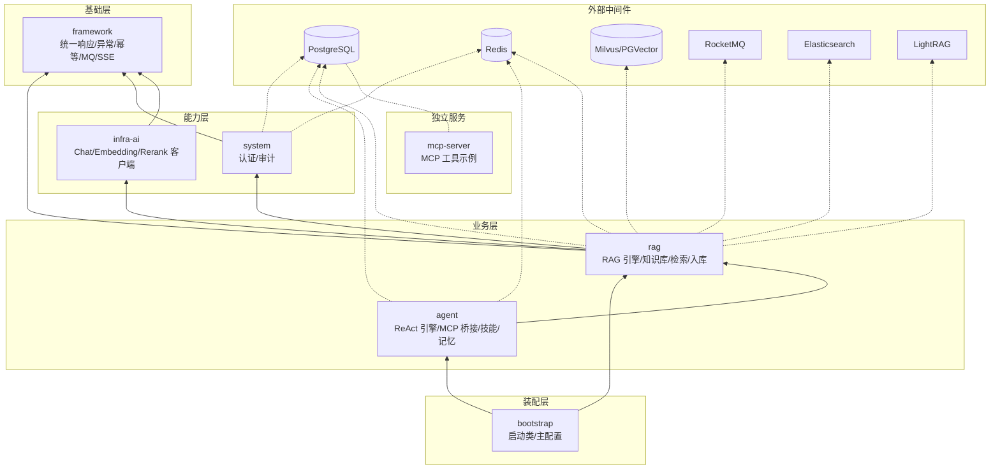
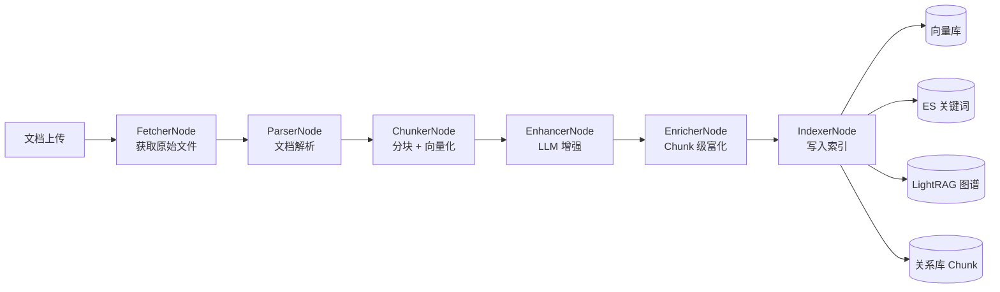
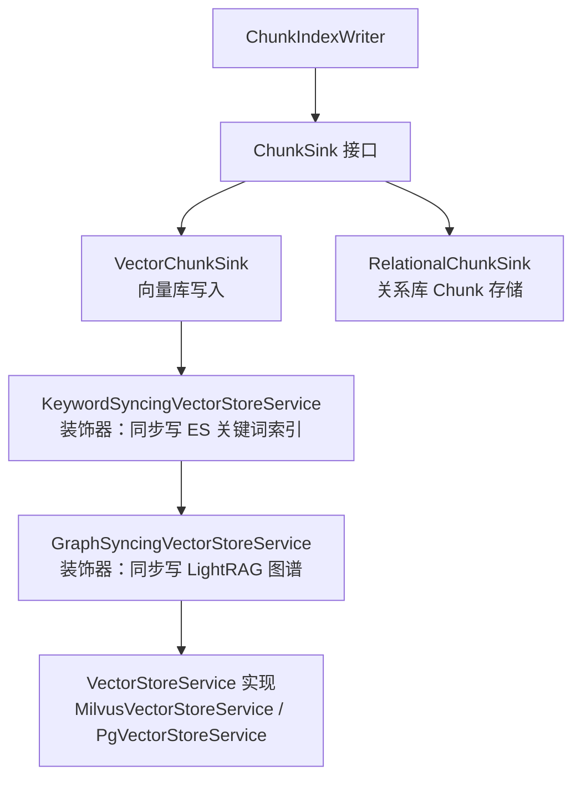
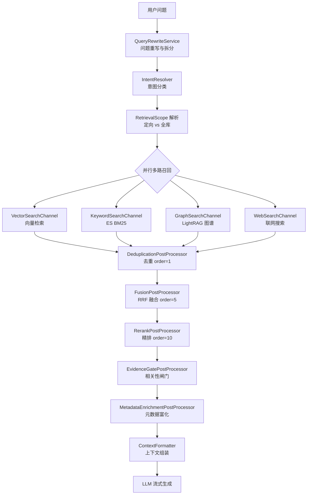

# Ragent 全局架构与核心链路拆解

> 本文档面向面试准备与源码阅读，结合具体类名和接口名，系统性拆解 Ragent 的模块架构、执行引擎和三条核心数据链路。

---

## 目录

1. [模块职责与依赖关系](#1-模块职责与依赖关系)
2. [v1 工作流 vs v2 Agent ReAct 引擎](#2-v1-工作流-vs-v2-agent-react-引擎)
3. [入库链路：解析 → 切片 → 向量化 → 存储](#3-入库链路解析--切片--向量化--存储)
4. [检索链路：意图识别 → 多路召回 → RRF 融合 → Rerank](#4-检索链路意图识别--多路召回--rrf-融合--rerank)
5. [Agent 循环：ReAct 推理与工具调用](#5-agent-循环react-推理与工具调用)
6. [面试高频问题与回答思路](#6-面试高频问题与回答思路)

---

## 1. 模块职责与依赖关系

### 1.1 模块总览

Ragent 采用前后端分离的模块化单体架构，后端按职责分为 7 个 Maven 模块：

| 模块 | 职责 | 关键类 |
|:---|:---|:---|
| **framework** | 基础设施层：统一响应、异常体系、幂等、分布式 ID、MQ 适配、SSE 流式、任务取消 | `Result`, `SseEmitterSender`, `StreamTaskManager`, `IdempotentSubmitAspect`, `SnowflakeIdInitializer` |
| **infra-ai** | AI 模型抽象层：Chat/Embedding/Rerank/VLM 客户端、模型档位路由、首包探测、健康检查 | `ChatClient`, `EmbeddingClient`, `RerankClient`, `LLMService`, `RoutingLLMService`, `ModelSelector` |
| **system** | 系统支撑域：用户认证（Sa-Token）、审计日志 | `AuthService`, `SaTokenConfig`, `BizChangeLogService` |
| **rag** | RAG 核心引擎：知识库、入库 Pipeline、意图树、多路检索、会话记忆、Prompt 组装 | `IngestionKernel`, `DocumentParser`, `RetrievalEngine`, `MultiChannelRetrievalEngine`, `SearchChannel`, `RAGPromptService` |
| **agent** | Agent 执行引擎：AgentScope ReAct 循环、MCP 工具桥接、技能体系、记忆管理、人工确认 | `ReActAgentProvider`, `AgentToolCatalog`, `McpToolBridge`, `AgentMemoryPipeline` |
| **bootstrap** | 启动装配层：仅含 `RagentApplication` 启动类与主配置，禁止业务代码入内 | `RagentApplication` |
| **mcp-server** | 独立 MCP 工具服务：天气、票务、销售、电商等示例工具，独立部署 | `McpServerApplication` |

### 1.2 模块依赖链



> `mcp-server` 是独立部署的 Spring Boot 应用，不依赖任何内部模块，通过 MCP 协议与主应用通信。

### 1.3 各模块核心包结构

#### framework — 基础设施层

| 包 | 职责 |
|:---|:---|
| `framework.convention` | 统一 DTO：`Result`, `ChatRequest`, `ChatMessage`, `RetrievedChunk`, `SourceRef` |
| `framework.web` | `GlobalExceptionHandler`, `SseEmitterSender`, `StreamTaskManager` |
| `framework.idempotent` | 幂等 AOP：`IdempotentSubmitAspect`, `IdempotentConsumeAspect` |
| `framework.distributedid` | 雪花 ID：`SnowflakeIdInitializer`, `CustomIdentifierGenerator` |
| `framework.mq.producer` | MQ 抽象：`MessageQueueProducer`, `RocketMQProducerAdapter` |
| `framework.cancellation` | 任务取消：`TaskCancellation` |
| `framework.context` | 用户上下文：`UserContext`, `LoginUser`（基于 TTL） |

#### infra-ai — AI 模型抽象层

| 包 | 职责 |
|:---|:---|
| `infra.chat` | LLM 客户端：`ChatClient` 接口 → `DeepSeekChatClient`, `BaiLianChatClient`, `AIHubMixChatClient`, `OllamaChatClient`, `SiliconFlowChatClient` |
| `infra.embedding` | Embedding 客户端：`EmbeddingClient` 接口 → `BaiLianEmbeddingClient`, `AIHubMixEmbeddingClient`, `OllamaEmbeddingClient`, `SiliconFlowEmbeddingClient` |
| `infra.rerank` | Rerank 客户端：`RerankClient` 接口 → `BaiLianRerankClient`, `NoopRerankClient` |
| `infra.vlm` | 视觉模型：`VlmService` → `RoutingVlmService`（图生文，用于入库图片解析） |
| `infra.model` | 模型路由：`ModelSelector`, `ModelRoutingExecutor`, `ModelHealthStore` |
| `infra.token` | Token 计数：`TokenCounterService` → `HeuristicTokenCounterService` |

#### rag — RAG 核心引擎

| 包 | 职责 |
|:---|:---|
| `core.parser` | 文档解析：`DocumentParser` 接口 → `TikaDocumentParser`, `MinerUDocumentParser` 等 |
| `core.chunk` | 分块策略：`BlockAwareChunkerDispatcher` → `BlockChunker<B>` 按 Block 类型分发 |
| `core.ingest` | 入库内核：`IngestionKernel` 5 步固定流程 + `ChunkSink` 存储扇出 |
| `core.vector` | 向量存取：`VectorRetrieverService`, `VectorStoreAdmin` → Milvus/PGVector 实现 |
| `core.keyword` | 关键词检索：`KeywordRetrieverService` → Elasticsearch BM25 |
| `core.graph` | 知识图谱：`GraphQueryService` → `LightRagClient` |
| `core.intent` | 意图分类：`IntentClassifier` → `DefaultIntentClassifier`，树形意图结构 |
| `core.retrieval` | 检索引擎：`MultiChannelRetrievalEngine` 并行多路召回 + 后处理链 |
| `core.retrieval.channel` | 搜索通道：`SearchChannel` 接口 → Vector/Keyword/Graph/Web 四通道 |
| `core.retrieval.postprocessor` | 后处理：Dedup → Fusion/RRF → Rerank → EvidenceGate |
| `core.memory` | 会话记忆：`ConversationMemoryService` → JDBC 持久化 + 摘要压缩 |
| `core.mcp` | MCP 工具：`McpToolRegistry`, `McpToolExecutor`, `McpClientAutoConfiguration` |
| `core.prompt` | Prompt 工程：`RAGPromptService`, `AgentPromptResolver` |
| `ingestion.engine` | 入库编排：`IngestionEngine` DAG 执行 + `IngestionNode` 各类节点 |
| `knowledge` | 知识库管理：CRUD + 定时刷新 + MQ 消费 |

#### agent — Agent 执行引擎

| 包 | 职责 |
|:---|:---|
| `agent.config` | 引擎构建：`ReActAgentProvider` 懒加载 + `AgentProperties` 配置 |
| `agent.tool` | 工具目录：`AgentToolCatalog` 交集解析 + `KnowledgeSearchTool`, `McpToolBridge` |
| `agent.memory` | 记忆管理：`AgentMemoryPipeline` 提取 + `AgentUserMemoryMiddleware` 注入 + `AgentContextCompactionMiddleware` 压缩 |
| `agent.skill` | 技能系统：`SkillLoadTool` + `AgentSkillMaskingMiddleware` 渐进式披露 |
| `agent.confirm` | 人工确认：`AgentConfirmDenialMiddleware` 拒绝处理 |
| `agent.trace` | 链路追踪：`AgentRunTracer`, `RagentOtelTracingMiddleware`（OpenTelemetry） |
| `agent.state` | 状态持久化：`PgAgentStateStore`（PostgreSQL） |

---

## 2. v1 工作流 vs v2 Agent ReAct 引擎

### 2.1 引擎切换机制

引擎类型通过 `application.yaml` 配置：

```yaml
ragent:
  engine:
    type: agent  # 可选 workflow（v1）/ agent（v2）
```

读取链路：`OrchestrationProperties` → `OrchestrationMode` 枚举（`WORKFLOW` / `AGENT`）。

关键条件装配注解 `@ConditionalOnAgentEngine`（等价于 `@ConditionalOnProperty(prefix="ragent.engine", name="type", havingValue="agent")`）控制 agent 模块所有 Bean 的加载。切换引擎需要重启应用。

### 2.2 HTTP 端点分离

两套引擎暴露**独立的 API 端点**，不共用路由：

| 引擎 | 端点 | Controller |
|:---|:---|:---|
| v1 (workflow) | `GET /api/ragent/rag/v3/chat` | `RAGChatController` |
| v2 (agent) | `GET /api/ragent/agent/v1/chat` | `AgentChatController` |
| v2 (confirm) | `POST /api/ragent/agent/v1/chat/confirm` | `AgentChatController` |

### 2.3 v1 工作流引擎

v1 是固定步骤的流水线，实现在 `StreamChatPipeline` 中：

```
用户提问
  │
  ▼
loadMemory ─── 加载会话历史，追加用户消息
  │
  ▼
rewriteQuery ── QueryRewriteService.rewriteWithSplit() 问题重写与拆分
  │
  ▼
resolveIntents ─ IntentResolver.resolve() 意图分类，产出 SubQuestionIntent
  │
  ├─[模糊查询]─→ handleGuidance ──→ 返回澄清提示（短路）
  │
  ├─[系统意图]─→ handleSystemOnly ─→ 直接 LLM 回答（短路）
  │
  ▼
retrieve ─────── RetrievalEngine.retrieve() 多路检索 + RRF + Rerank
  │
  ├─[无结果]──→ handleEmptyRetrieval → 返回"未找到相关内容"（短路）
  │
  ▼
streamRagResponse ── Prompt 组装 → LLM 流式生成 → 引用标注 → SSE 输出
```

**核心类**：`StreamChatPipeline`, `RAGChatServiceImpl`, `RAGChatController`

**设计特点**：路径固定，每一步可预测，适合问答类知识助手。短路机制避免不必要的 LLM 调用。

### 2.4 v2 Agent ReAct 引擎

v2 基于 AgentScope 框架的 `ReActAgent`，路径由模型动态决定：

```
用户提问
  │
  ▼
AgentChatServiceImpl.chat()
  │
  ├─ AgentRunGate 获取会话级并发锁
  ├─ 构建 RuntimeContext（userId, sessionId, taskFacts）
  │
  ▼
ReActAgent.streamEvents(input, runtimeContext)
  │
  ▼
┌─────────────────────────────────────────┐
│           ReAct 循环（maxIters=10）        │
│                                         │
│  ┌─ 中间件链（onReasoning）──────────────┐ │
│  │ OtelTracing → TraceEnrichment       │ │
│  │ → UserMemory → ContextCompaction    │ │
│  │ → ConfirmDenial → SkillMasking      │ │
│  │ → ToolBatch                         │ │
│  └─────────────────────────────────────┘ │
│           │                              │
│           ▼                              │
│    LLM 推理（Think）                      │
│           │                              │
│           ▼                              │
│    工具选择（Act）                         │
│     ├─ search_knowledge → 检索链路         │
│     ├─ load_skill → 加载技能手册           │
│     ├─ flush_memory → 刷新长期记忆         │
│     └─ MCP 工具 → McpToolBridge → 远程调用 │
│           │                              │
│           ▼                              │
│    工具执行结果（Observe）                  │
│           │                              │
│     ┌─────┘                              │
│     ▼                                    │
│  继续循环 or 输出最终回答                   │
└─────────────────────────────────────────┘
  │
  ▼
AgentStreamEventBridge → SSE 事件流 → 前端实时展示
```

**核心类**：`ReActAgentProvider`, `AgentChatServiceImpl`, `AgentChatController`, `AgentStreamEventBridge`

**中间件链执行顺序**（从外到内，每个中间件实现 `onReasoning`/`onActing`）：

| 顺序 | 中间件 | 职责 |
|:---|:---|:---|
| 1 | `RagentOtelTracingMiddleware` | OpenTelemetry 分布式追踪 Span |
| 2 | `AgentTraceEnrichmentMiddleware` | 丰富 Trace 属性 |
| 3 | `AgentUserMemoryMiddleware` | 注入跨会话长期记忆（USER 角色消息） |
| 4 | `AgentContextCompactionMiddleware` | 50% 水位裁剪工具结果，80% 水位 LLM 摘要压缩 |
| 5 | `AgentConfirmDenialMiddleware` | 重写用户取消确认时的默认拒绝文本 |
| 6 | `AgentSkillMaskingMiddleware` | 隐藏未加载技能的工具（渐进式披露） |
| 7 | `AgentToolBatchMiddleware` | 跟踪工具执行批次的可观测性 |

### 2.5 为什么这样设计

| 维度 | v1 (workflow) | v2 (agent) |
|:---|:---|:---|
| **执行路径** | 固定流水线，代码决定每一步 | 模型动态决定，ReAct 循环自主规划 |
| **适用场景** | 简单知识问答，路径可预测 | 复杂任务（下单、修改数据、多步推理） |
| **工具使用** | MCP 工具在检索引擎中直接调用 | 工具作为 Agent 的能力，由模型选择调用 |
| **可观测性** | Trace 按固定步骤记录 | Trace 记录每轮推理-行动-观察 |
| **容错** | 单通道失败不影响主链 | maxIters 熔断 + 中间件链逐层保障 |
| **Token 成本** | 较低（固定步骤，无循环） | 较高（多轮推理，但按需调用） |

两套引擎**并存而非替代**：问答类需求走 v1 更快更可控，需要规划和操作的场景交给 v2。

---

## 3. 入库链路：解析 → 切片 → 向量化 → 存储

### 3.1 整体流程

入库链路有两层编排：底层 `IngestionKernel`（5 步固定骨架）和高层 `IngestionEngine`（可配置节点链 DAG）。



### 3.2 解析层

**接口**：`DocumentParser`
- `parseStructured(byte[] data, String mimeType, Map options)` → `ParsedDocument`
- `supportedMimeTypes()` → `Map<ParseProfile, Set<String>>`（FAST / FIDELITY 两种保真度）

**注册表**：`ParserRegistry` — 启动时按 (MIME 类型 × ParseProfile) 注册解析器，冲突则 fail-fast。

**实现**：

| 解析器 | 适用格式 | 特点 |
|:---|:---|:---|
| `TikaDocumentParser` | 纯文本/HTML/JSON/XML/RTF | 兜底解析，仅产出 `ParagraphBlock` |
| `MinerUDocumentParser` | PDF/Word/PPT | 调用 MinerU SaaS API，Redis 分布式信号量控制并发 |
| `MarkdownDocumentParser` | Markdown | 保留标题层级 |
| `CsvDocumentParser` | CSV | 表格结构化 |
| `ExcelDocumentParser` | Excel | 表格结构化 |
| `ImageDocumentParser` | 图片 | 调用 VLM 图生文 |

**Block 模型**：解析产物是类型化的 Block 列表：
- `ParagraphBlock` — 段落文本
- `HeadingBlock` — 标题（携带层级信息）
- `TableBlock` — 表格
- `CodeBlock` — 代码块
- `ListBlock` — 列表
- `ImageBlock` — 图片（含 VLM 描述文本）
- `HtmlTableBlock` — HTML 表格

### 3.3 切片层

**调度器**：`BlockAwareChunkerDispatcher` — 策略模式，`Map<Class<? extends Block>, BlockChunker<?>>` 注册表。

**流程**：
1. 遍历 Block 列表
2. `HeadingHandler` 维护当前标题路径（outline path）
3. 按 Block 类型分发到对应的 `BlockChunker<T>`
4. `ChunkPacker` 按 Section 合并 Draft
5. `ChunkAssembler` 产出最终 `Chunk` 列表

**BlockChunker 实现**：

| 分块器 | 处理的 Block | 策略 |
|:---|:---|:---|
| `ParagraphChunker` | `ParagraphBlock` | 按 maxChars 切分，保留 overlap |
| `HeadingChunker` | `HeadingBlock` | 标题作为分割点，不独立成 Chunk |
| `TableChunker` | `TableBlock` | 整表作为一个 Chunk，超大表按行切分 |
| `CodeChunker` | `CodeBlock` | 保留代码完整性，按 maxChars 切分 |
| `ListChunker` | `ListBlock` | 保持列表结构 |
| `ImageChunker` | `ImageBlock` | 图片描述文本 + 图片引用 |
| `HtmlTableChunker` | `HtmlTableBlock` | HTML 表格转文本 |

**预算模型**：`ChunkBudget`（maxChars, overlap, rowsPerChunk）。`-1` 表示整文档单 Chunk 模式。

### 3.4 向量化

**服务**：`ChunkEmbeddingService`
- 输入：`List<Chunk>` + `VectorTarget`（partition, embeddingModel, dimension）
- 调用 `EmbeddingService.embedBatch(texts, model)` → 产出 `List<EmbeddedChunk>`（Chunk + float[] 向量）
- **维度校验**：向量维度与物理向量空间不匹配时立即抛异常，防止错误流入向量库

### 3.5 存储扇出

**核心**：`ChunkIndexWriter` 在单个 Spring 事务内扇出到所有注册的 `ChunkSink` Bean。



**装饰器链**（关键设计）：
- `KeywordSyncingVectorStoreService` — 包装 `VectorStoreService`，写向量时同步写 ES 关键词索引。**Best-effort**：ES 失败只记日志，不回滚向量写入。
- `GraphSyncingVectorStoreService` — 包装上层，写向量时同步写 LightRAG 图谱。将 Chunk 内容拼接为完整文档文本供图谱抽取。同样是 Best-effort。

**扩展方式**：新增索引后端 = 新增一个 `ChunkSink` Bean，入库主流程无需改动。

### 3.6 高层编排：IngestionEngine

`IngestionEngine` 构建 DAG，按拓扑序执行 `IngestionNode`：

| 节点 | 类型 | 职责 |
|:---|:---|:---|
| `FetcherNode` | FETCHER | 按 `SourceType` 策略获取原始文件（`HttpUrlFetcher`, `FeishuFetcher`） |
| `ParserNode` | PARSER | 调用 `DocumentParser` 解析为 Block 列表 |
| `ChunkerNode` | CHUNKER | 调用 `ChunkingService.chunk()` + `ChunkEmbeddingService.embed()` |
| `EnhancerNode` | ENHANCER | LLM 文档级增强（关键词提取、问题生成、元数据提取） |
| `EnricherNode` | ENRICHER | LLM Chunk 级富化（每 Chunk 的摘要、关键词、元数据） |
| `IndexerNode` | INDEXER | 确保向量空间存在，调用 `VectorStoreService.indexDocumentChunks()` |

每个节点配置可附带 `Condition`（`ConditionEvaluator` 求值），支持条件跳过。

---

## 4. 检索链路：意图识别 → 多路召回 → RRF 融合 → Rerank

### 4.1 整体流程



### 4.2 意图识别

**接口**：`IntentClassifier` → `classifyTargets(String question)` → `List<NodeScore>`

**实现**：`DefaultIntentClassifier`
- 从 Redis 缓存（回退 PostgreSQL）加载意图树
- 意图树结构：`IntentNode` 树形层级（DOMAIN > CATEGORY > TOPIC）
- 叶子节点类型：`KB`（知识库，含 collectionNames）、`MCP`（MCP 工具，含 mcpToolId）、`SYSTEM`（系统指令）
- LLM 打分：将所有候选叶子节点的 id/path/description/examples 送入单次 LLM 调用，输出 JSON `[{id, score, reason}]`
- 过滤：score 低于阈值的节点被剔除

**作用域解析**：`RetrievalScope`
- **定向模式**：意图最高分 ≥ `confidence-threshold` → 仅检索命中的知识库
- **全库模式**：最高分 < 阈值 → 退化为全库检索
- **补充路**：从主路配额中划出 `supplement-ratio` 比例，检索未命中的知识库，兜住意图分类错误

### 4.3 多路并行召回

**编排**：`MultiChannelRetrievalEngine`
- 通过 `CompletableFuture` 并行执行所有启用的 `SearchChannel`
- 每通道独立超时（`channels.timeout-ms`，默认 15s）
- **容错**：单通道超时或异常不影响其他通道，结果中该通道返回空列表

#### VectorSearchChannel（向量检索）

最复杂的通道，支持定向和全库两种模式：

1. **Embedding 共享**：查询向量只计算一次，主路和补充路共享
2. **定向路径**：查询命中的 collection
3. **补充路径**：查询未命中的 collection，`ScopeQuota.split()` 分配配额
4. **跨集合检索**：后端支持全局检索（`supportsGlobalRetrieval()`）时单次查询；否则按 collection 并行扇出（`CollectionParallelRetriever`）

#### KeywordSearchChannel（关键词检索）

- 条件注册：`rag.keyword.type=es` 时启用
- Elasticsearch BM25 检索，同样的定向/补充双路径模式

#### GraphSearchChannel（图谱检索）

- 条件注册：`rag.graph.type=lightrag` 时启用
- 调用 `LightRagClient.retrieveByScope()`
- 定向模式下 top_k 放大 3 倍以补偿后过滤损失
- 结果侧按 collection 过滤（LightRAG 无请求级 workspace 隔离）

#### WebSearchChannel（联网搜索）

- You.com Search API，合并 `web` 和 `news` 结果
- 评分：`1/(rank+1)`，按排名递减
- 仅在 `rag.search.channels.web-search.enabled=true` 且 API Key 可用时启用

### 4.4 RRF 融合

**类**：`FusionPostProcessor`（order=5）

**公式**：
```
score(chunk) = Σ [weight_channel / (k + rank_channel)]
```

- `k`：RRF 常数（默认 20，候选池 20~40 条时 k=60 会过度平滑）
- `weight_channel`：每通道可配置权重（vector: 1.0, keyword: 1.0, graph: 0.8, web-search: 0.5）
- 单通道查询跳过融合，直接截断
- 融合后截断至 `rerank-candidate-limit`（默认 40），控制 Rerank 成本

### 4.5 Rerank

**类**：`RerankPostProcessor`（order=10）

- 调用 `RerankService.rerank(query, candidates, topN)`
- `topN` = `default-top-k`（默认 10），即最终进 LLM 的条数
- 记录分数分布和每通道归因，用于运营监控

**EvidenceGatePostProcessor**：整批最高精排分低于 `min-rerank-score`（默认 0.2）时整批丢弃，避免低质量结果污染 LLM 上下文。

### 4.6 检索漏斗三段预算

| 阶段 | 配置项 | 默认值 | 说明 |
|:---|:---|:---|:---|
| ① 召回 | `recall-budget` | 20 | 每通道召回条数 |
| ② 融合+精排 | `rerank-candidate-limit` | 40 | RRF 融合后送入 Rerank 的候选池上限 |
| ③ 进 LLM | `default-top-k` | 10 | 最终进入 Prompt 的条数 |

约束：`recall-budget ≥ default-top-k`，`rerank-candidate-limit ≥ default-top-k`，启动时校验。

---

## 5. Agent 循环：ReAct 推理与工具调用

### 5.1 ReAct 引擎构建

**类**：`ReActAgentProvider` — 懒加载单例，仅在 persona 文本或工具目录指纹变化时重建 Agent。

```
ReActAgent agent = ReActAgent.builder()
    .name("RagentAI")
    .sysPrompt(persona)           // AgentPromptResolver 解析
    .model(agentChatModel)         // OpenAIChatModel（按 provider 配置）
    .toolkit(toolCatalog.buildToolkit(catalog))
    .maxIters(10)                  // ReAct 循环上限
    .maxRetries(1)                 // 每轮重试次数
    .stateStore(agentStateStore)   // PgAgentStateStore（PostgreSQL）
    .middleware(userMemoryMiddleware)
    .middleware(contextCompactionMiddleware)
    .middleware(confirmDenialMiddleware)
    .middleware(skillMaskingMiddleware)
    .middleware(toolBatchMiddleware)
    .build();
```

### 5.2 工具目录解析

**类**：`AgentToolCatalog.resolve()` — 交集运算确定可用工具：

```
可用工具 = (McpToolRegistry 中的工具 ∩ IntentNodeRegistry 中的 MCP 工具节点)
         + 内置工具（search_knowledge, flush_memory, load_skill）
```

- **内置工具**：
  - `search_knowledge`（`KnowledgeSearchTool`）— 调用 `KnowledgeSearchFacade` 执行完整检索链路
  - `flush_memory`（`MemoryFlushTool`）— 刷新长期记忆快照
  - `load_skill`（`SkillLoadTool`）— 加载技能手册，解锁对应工具
- **MCP 工具**：每个工具携带 `readOnly`、`needsConfirm`、`inputSchema` 元数据
- 产出 `ResolvedCatalog` 快照 + 指纹，用于变更检测

### 5.3 MCP 工具集成（三层架构）

#### 第一层：发现与注册

```mermaid
graph LR
    CFG[application.yaml<br/>rag.mcp.servers] --> AUTO[McpClientAutoConfiguration<br/>@PostConstruct]
    AUTO --> TRANSPORT[HttpClientStreamableHttpTransport<br/>连接 url/mcp]
    TRANSPORT --> CLIENT[McpClient.sync(transport).build()<br/>client.initialize()]
    CLIENT --> LIST[client.listTools()<br/>发现远程工具]
    LIST --> EXEC[McpClientToolExecutor<br/>包装每个 Tool]
    EXEC --> REG[DefaultMcpToolRegistry<br/>HashMap 注册表]
```

- `McpClientProperties` 读取 `rag.mcp.servers` 配置
- 每个 Server 创建 `HttpClientStreamableHttpTransport` → `McpClient` → `initialize()` → `listTools()`
- 每个发现的 `Tool` 包装为 `McpClientToolExecutor`，注册到 `DefaultMcpToolRegistry`
- 同时自动发现 Spring 容器中所有 `McpToolExecutor` Bean

#### 第二层：工具解析

`AgentToolCatalog.resolve()` 将 MCP 注册表与意图树 MCP 节点取交集，确保只有同时具备运行中的 Executor 和意图树配置的工具才暴露给 Agent。

#### 第三层：执行桥接

**类**：`McpToolBridge` — 将 `McpToolExecutor` 适配为 AgentScope 的 `ToolBase`：

1. `checkPermissions()` — 根据 `needsConfirm` 返回 `ask`（需确认）或 `allow`（直接执行）
2. `maskedBySkill()` — 检查工具是否被技能遮蔽，若是则返回提示让模型先加载技能
3. `executor.execute(input, McpCallMeta)` — 实际调用远程 MCP Server
4. 将 `CallToolResult` 转换为 AgentScope 的 `ToolResultBlock`

### 5.4 技能系统（渐进式披露）

技能实现"先看清单，按需加载"的模式：

1. **技能注册**：`AgentSkillRegistry` 从 PostgreSQL 读取启用的技能（`AgentSkillDO`），Redis 缓存（1 小时 TTL）
2. **工具可见性控制**：`AgentSkillMaskingMiddleware` 在每轮推理前计算 `masked = (所有技能的 tool_ids) - (已加载技能的 tool_ids)`，从模型的工具列表中隐藏
3. **技能加载**：模型调用 `load_skill(skill_code="xxx")` → `SkillLoadTool` 返回技能手册内容 + 解锁的工具名
4. **自动解锁**：技能手册出现在上下文后，下一轮推理自动取消对应工具的遮蔽
5. **自动回收**：技能手册被上下文压缩移除时，对应工具自动回到遮蔽状态（"同生同灭"）

### 5.5 记忆管理（三层）

| 层次 | 类 | 职责 |
|:---|:---|:---|
| **注入** | `AgentUserMemoryMiddleware` | 每会话首次调用时从 PostgreSQL 加载长期记忆快照，渲染为 USER 消息注入 system prompt 之后 |
| **压缩** | `AgentContextCompactionMiddleware` | 50% 水位裁剪工具结果体（`AgentContextTrimmer`），80% 水位 LLM 摘要压缩旧轮次（`AgentContextCompactor`） |
| **提取** | `AgentMemoryPipeline` | 后台异步提取：读快照 → `AgentMemoryJudge` 仲裁 → `AgentMemoryConsolidator` 容量管理 → `AgentMemoryCommit` 提交 |

### 5.6 人工确认机制

写操作（如下单、修改数据）需要用户确认：

1. `McpToolBridge.checkPermissions()` — `needsConfirm=true` 时返回 `PermissionDecision.ask(...)`
2. AgentScope 框架暂停执行，向前端推送确认卡片
3. 用户点击确认 → `POST /api/ragent/agent/v1/chat/confirm` → 恢复执行
4. 用户点击取消 → `AgentConfirmDenialMiddleware` 将框架默认的 "Permission denied" 替换为自然语言解释："用户点击了取消，此操作未执行，这不是权限问题或系统故障。"

---

## 6. 面试高频问题与回答思路

### Q1: "RAG 系统的检索召回率不够怎么办？"

**回答框架**（对应 Ragent 的实现）：

1. **查询侧优化**：
   - 问题重写：`QueryRewriteService.rewriteWithSplit()` 将口语化问题转为检索友好格式
   - 查询词映射：`QueryTermMappingService` 建立同义词/业务术语映射
   - 多问题拆分：复杂问题拆分为子问题，每个子问题独立检索

2. **多路召回**：
   - 不要只用向量检索。向量擅长语义匹配，关键词擅长精确匹配，图谱擅长关系推理
   - Ragent 的 `MultiChannelRetrievalEngine` 并行执行 4 个通道，单通道失败不影响其他

3. **融合排序**：
   - RRF 融合（`FusionPostProcessor`）将多通道结果统一排序
   - 可配置通道权重，根据业务特点调整

4. **精排**：
   - Rerank 二次排序（`RerankPostProcessor`）大幅提升准确率
   - EvidenceGate 闸门过滤低质量结果

5. **意图路由**：
   - `DefaultIntentClassifier` 将问题路由到相关知识库，避免全库噪声

### Q2: "Agent 和传统 RAG 的区别？什么时候用哪个？"

**回答框架**：

| 维度 | 传统 RAG (v1) | Agent (v2) |
|:---|:---|:---|
| 执行路径 | 代码写死的固定流水线 | 模型动态决定，ReAct 循环 |
| 工具使用 | MCP 工具在检索引擎中直接调用 | 工具是 Agent 的能力，模型选择何时调用 |
| 适用场景 | 简单知识问答（"XX 政策是什么"） | 复杂任务（"帮我下单"、"对比两个方案"） |
| Token 成本 | 低（固定步骤） | 高（多轮推理） |
| 可控性 | 高（路径可预测） | 较低（路径由模型决定） |
| 灵活性 | 低（改路径要改代码） | 高（加工具即可扩展能力） |

**Ragent 的设计**：两套并存。`ragent.engine.type` 配置切换，简单场景用 v1，复杂场景用 v2。

### Q3: "如何保证 RAG 系统的生产级可用性？"

**回答框架**（按维度展开）：

1. **模型容错**：
   - 多候选模型自动切换：`ModelSelector` + `ModelRoutingExecutor`
   - 首包超时探测：`LlmFirstPacketProbe` 检测首包延迟
   - 三态熔断：`ModelHealthStore` 隔离故障节点

2. **流量保护**：
   - Redis ZSET 公平排队 + Lua 原子抢占
   - 分布式信号量控制文档上传并发

3. **检索稳定性**：
   - 多通道并行，单通道失败不影响主链
   - 按 recall → rerank → topK 分层控制检索规模
   - EvidenceGate 闸门过滤低质量结果

4. **数据一致性**：
   - RocketMQ 事务消息保障分块可靠执行
   - 幂等注解（`@IdempotentSubmit`）防止重复处理
   - 远程文档刷新使用分布式锁 + 状态机

5. **可观测性**：
   - Trace 记录每步耗时、输入输出、异常
   - Agent 侧 OpenTelemetry + Langfuse 集成
   - 管理后台提供趋势、详情、配置变更 Diff

6. **会话与上下文**：
   - 会话记忆：最近 N 轮 + 持久化摘要，控制 Token 成本
   - Agent 三层记忆：注入 → 压缩 → 提取
   - SSE 流式输出 + 全局超时 + 客户端断开取消
