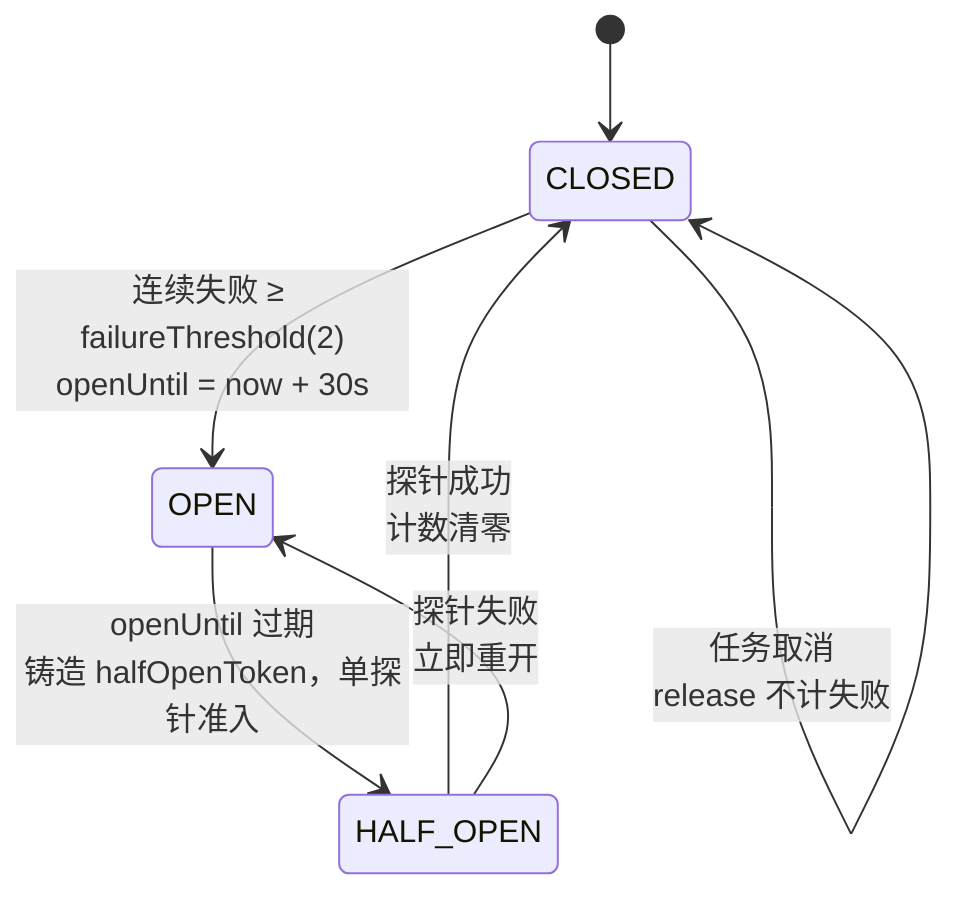
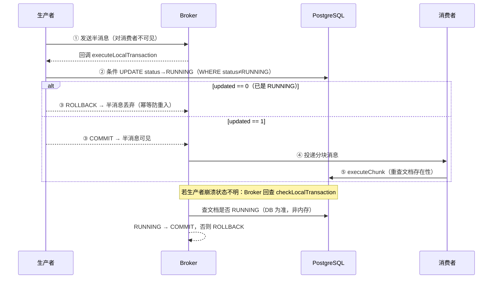

# Ragent 核心技术深挖与设计模式解析

> 本文是 [01-Architecture-and-DataFlow](./01-Architecture-and-DataFlow.md) 的微观深挖篇：01 讲链路全景与模块结构，本文聚焦代码级机制与工程取舍——设计模式的具体落点、infra-ai 的路由/熔断/降级、全库最复杂的技术难点，以及基于源码的面试深挖回答。

---

## 目录

1. [三大核心设计模式深挖](#1-三大核心设计模式深挖)
2. [infra-ai：模型路由、熔断与降级](#2-infra-ai模型路由熔断与降级)
3. [最复杂的技术难点](#3-最复杂的技术难点)
4. [面试深挖问题与高分回答](#4-面试深挖问题与高分回答)

---

## 1. 三大核心设计模式深挖

CLAUDE.md 列出了 9 种设计模式，这里挑对企业级 RAG 最关键、面试最有区分度的 3 个，逐一拆解"接口 → 实现 → 装配 → 痛点"。

### 1.1 Middleware（中间件模式）— Agent 横切能力插拔

**解决的痛点**：ReAct 引擎主循环（AgentScope 框架）不应该感知记忆注入、上下文压缩、技能遮蔽、链路追踪这些横切关注点。如果直接写进引擎，每加一个能力就要改一次核心循环；用中间件链，每个能力独立开关、独立排序、独立测试。

**接口**（AgentScope 框架提供）：

```java
public abstract class MiddlewareBase {
    // 每轮 LLM 推理前触发，可改写 input（消息/工具），必须调用 next.apply 续接或短路
    Flux<AgentEvent> onReasoning(Agent agent, RuntimeContext ctx, ReasoningInput input,
                                 Function<ReasoningInput, Flux<AgentEvent>> next);
    // 每次工具执行前触发
    Flux<AgentEvent> onActing(Agent agent, RuntimeContext ctx, ActingInput input,
                              Function<ActingInput, Flux<AgentEvent>> next);
    int order();  // 越小越靠内层
}
```

**7 层具体实现**（洋葱结构，从外到内）：

| 层 | 类 | 钩子 | 职责与关键细节 |
|:---|:---|:---|:---|
| 1 | `RagentOtelTracingMiddleware` | onActing | 最外层 Span，`doOnComplete/doOnError/doOnCancel` 三种信号都结束 Span——盖住记忆与压缩才量得到真实耗时 |
| 2 | `AgentTraceEnrichmentMiddleware` | — | 丰富 Trace 属性 |
| 3 | `AgentUserMemoryMiddleware` | onReasoning | 首轮回合离线（`boundedElastic`）加载 DB 长期记忆快照，缓存进 `RuntimeContext`，以 USER 消息注入 persona 之后 |
| 4 | `AgentContextCompactionMiddleware` | onReasoning | 50% 上下文水位触发 `AgentContextTrimmer` 裁剪工具结果体；80% 水位触发 `AgentContextCompactor` LLM 摘要压缩旧轮次 |
| 5 | `AgentConfirmDenialMiddleware` | onReasoning | 把框架默认拒绝文案 "Permission denied by user" 重写为自然解释——防止 LLM 把用户取消误读成权限故障后开始"道歉并分析原因" |
| 6 | `AgentSkillMaskingMiddleware` | onReasoning，`order()=0` | `masked = ∪(全部启用技能 tool_ids) − ∪(已加载技能 tool_ids)`，从 `input.tools()` 过滤；遮蔽表存 `RuntimeContext` 供执行侧二次校验 |
| 7 | `AgentToolBatchMiddleware` | onActing，`order()=0` | `facts.beginBatch()` → `next.apply(input).doFinally(... endBatch)`——批起止贴着真实执行，用于可观测性 |

**装配**（`ReActAgentProvider.buildAgent()`，注释即设计文档）：

```java
// 追踪包在最外层：span 要盖住记忆与压缩才量得到耗时
otelTracingMiddleware.ifAvailable(builder::middleware);
traceEnrichmentMiddleware.ifAvailable(builder::middleware);
return builder
        .middleware(userMemoryMiddleware)          // 外层先执行
        .middleware(contextCompactionMiddleware)
        .middleware(confirmDenialMiddleware)       // 压缩之后
        .middleware(skillMaskingMiddleware)        // 手册被压缩带走后遮蔽跟着复位
        .middleware(toolBatchMiddleware)           // 最内层：批起止贴着真实执行
        .build();
```

**面试亮点**：顺序不是随意排的——追踪在最外才能量到全链路耗时；技能遮蔽在压缩之后，才能实现"技能手册被上下文压缩移除后，对应工具自动回到遮蔽状态"的同生同灭语义。

### 1.2 Decorator（装饰器模式）— 向量写入同步多索引

**解决的痛点**：每次写向量，都要同步维护 ES 关键词索引和 LightRAG 图谱。如果写进入库主流程，调用点会散落 try-catch；如果辅索引失败回滚主写入，会因 ES/图谱不稳定拖垮核心链路。装饰器让"增强"与"主流程"彻底解耦。

**接口与真实实现**：

```java
public interface VectorStoreService {
    void indexDocumentChunks(String collectionName, String docId, List<EmbeddedChunk> chunks);
    void updateChunk(String collectionName, String docId, EmbeddedChunk chunk);
    void deleteDocumentVectors(String collectionName, String docId);
    // ...
}
```

真实实现 `MilvusVectorStoreService` / `PgVectorStoreService` 由 `@ConditionalOnProperty(name = "rag.vector.type")` 二选一。

**两个装饰器**（同包 `rag/core/vector/decorator/`）：

```java
// KeywordSyncingVectorStoreService — 先委托，后 best-effort 同步
@Override
public void indexDocumentChunks(String collectionName, String docId, List<EmbeddedChunk> chunks) {
    delegate.indexDocumentChunks(collectionName, docId, chunks);   // 主向量写入
    syncKeyword(docId, () -> keywordIndexService.indexDocumentChunks(collectionName, docId, chunks));
}
// best-effort：失败仅 warn，永不回滚主写入
private void syncKeyword(String docId, Runnable action) {
    try { action.run(); } catch (Exception e) { log.warn("关键词索引同步失败，已跳过 docId={}", docId, e); }
}
```

`GraphSyncingVectorStoreService` 形状相同，但只同步**文档级**操作（`indexDocumentChunks`/`deleteDocumentVectors`）——图谱抽取是文档粒度的，chunk 级操作刻意跳过，避免 chunkId→docId 反查。

**装配**（透明包裹，调用方无感知）：

- `KeywordSyncVectorStorePostProcessor` / `GraphSyncVectorStorePostProcessor`（均为 `BeanPostProcessor`）：容器里存在 `KeywordIndexService`（即 `rag.keyword.type=es`）或 `LightRagClient` 时，就把任意裸的 `VectorStoreService` Bean 包上对应装饰器
- 组合链：`GraphSyncing(KeywordSyncing(真实实现))`，两个开关独立、顺序无关
- 最低优先级的 `VectorChunkSink` 委托给装饰器链，于是**所有**向量写入调用点（入库、更新、删除）自动获得多索引同步

**面试亮点**：辅索引故障"只降级不扩散"——ES 挂了，向量和图谱照常写；图谱挂了，向量和 ES 照常写。这是生产级系统对"最终一致性辅索引"的标准处理。

### 1.3 Chain of Responsibility（责任链模式）— 双链协同

项目里有两条责任链共享同一思想：**每级独立可配、单级故障不拖垮整链**。

**链一：检索后处理链**

接口 `SearchResultPostProcessor`（`getName()` / `getOrder()` / `isEnabled()` / `process()`），执行器在 `MultiChannelRetrievalEngine.executePostProcessors`：

```java
List<SearchResultPostProcessor> enabled = postProcessors.stream()
        .filter(p -> p.isEnabled(context))
        .sorted(Comparator.comparingInt(SearchResultPostProcessor::getOrder)).toList();
for (SearchResultPostProcessor processor : enabled) {
    try { chunks = processor.process(chunks, results, context); }
    catch (Exception e) { log.error("后置处理器 {} 执行失败，跳过该处理器", ...); }  // 断链跳过
}
```

| Order | 处理器 | 职责 |
|:---|:---|:---|
| 1 | `DeduplicationPostProcessor` | 跨通道去重（`RetrievedChunkKey`，首个实例胜出），刻意不比较跨通道裸分——排序是 RRF 的活 |
| 5 | `FusionPostProcessor` | RRF 融合 + 截断至 candidateLimit |
| 10 | `RerankPostProcessor` | 精排 + 分数分布与通道归因日志 |
| 15 | `EvidenceGatePostProcessor` | 批级证据闸门（max 分 < 阈值整批丢弃） |
| 20 | `MetadataEnrichmentPostProcessor` | 回表富化元数据 |

**链二：模型降级链**（`ModelRoutingExecutor.executeWithFallback`）：

```java
for (ModelTarget target : targets) {                    // 候选已按优先级排序
    C client = clientResolver.apply(target);
    ModelHealthStore.CallPermit permit = healthStore.allowCall(target.id());
    if (permit == null) continue;                       // 熔断打开 → 跳过不试
    try { T r = caller.call(client, target); healthStore.markSuccess(target.id()); return r; }
    catch (Exception e) {
        if (TaskCancellation.isCancellation(e)) throw e;  // 取消 ≠ 模型故障，不计失败
        healthStore.markFailure(target.id());              // 可能触发熔断
    }
}
throw new RemoteException("All " + label + " model candidates failed: ...");
```

**面试亮点**：两条链的"故障语义"不同——检索链单级异常跳过（结果降质但可用），模型链失败切换候选（结果不变但延迟增加）。按故障后果选容错策略，不是一刀切 try-catch。

---

## 2. infra-ai：模型路由、熔断与降级

### 2.1 档位机制（Tier）

`Tier` 枚举三个档位，键对应 `ai.chat.tiers` 的 YAML 节点：

| 档位 | timeout-ms | 典型用途 |
|:---|:---|:---|
| `fast` | 5000 | 标题生成、歧义检测、问题重写、摘要 |
| `standard` | 120000 | 默认问答（`default-tier`） |
| `deep` | 180000 | 深度思考（`deep-thinking-tier`，`thinking=true` 自动路由） |

**timeout 双语义**（`ChatTierConfigValidator` 文档注释）：**流式 = 首包 TTFT 预算；同步 = 整段调用上限**。一个配置项同时服务两种调用形态。

### 2.2 ModelSelector：两级筛选

`selectChatCandidates(thinking, tier, preferredModelId)` 流程：

1. **档位解析**：`thinking=true` 且配置了 deep-thinking-tier → deep 档；否则 override 档 → 否则 default 档
2. **构建有序 ID**：preferredModelId（需在候选注册表且支持 thinking）置顶 → 追加档位 candidates（去重）
3. **逐候选过滤**：不在注册表 / `enabled=FALSE` / 需要 thinking 但候选不支持 → 跳过
4. **熔断预筛**：`healthStore.isUnavailable(modelId)` 的候选在**选择阶段**就被剔除——熔断模型根本不进入回退序列
5. **构建 ModelTarget**：附带命中档位的 `timeoutMs`

**启动 fail-fast**（`ChatTierConfigValidator implements InitializingBean`）——结构性错误直接拒绝启动，而非运行时静默降质：

- 档位缺正数 `timeout-ms` 或空候选列表 → `IllegalStateException`
- deep-thinking 档没有任何 **enabled + supportsThinking** 的候选 → 拒绝启动（否则 thinking 请求会过滤到空列表，运行时才炸）
- 重复候选 id、default/deep-thinking-tier 引用不存在的档位 → 拒绝启动

### 2.3 ModelHealthStore：三态熔断

每模型独立状态（`ConcurrentHashMap<String, ModelHealth>`），核心字段：`concurrentFailures`、`openUntil`、`halfOpenInFlight`、`halfOpenToken`、`state`。



**三个精妙细节**（多数开源熔断器不具备）：

1. **token 防误释放**：`releaseHalfOpenPermit(permit)` 校验 `halfOpenToken == permit.halfOpenToken()`——过期调用者释放的是旧探针的槽位，不能误放行新探针的准入
2. **取消不计失败**：`TaskCancellation.isCancellation(e)` 识别的异常走 release 路径，不 `markFailure`——用户点停止不该算模型故障
3. **HALF_OPEN 严格单探针**：`halfOpenInFlight` CAS 占位，同一时刻只有一个探针流量

**配套测试** `RoutingLLMServiceHalfOpenRecoveryTest` 覆盖全部边界：中断释放 permit、stale permit 无法释放新 probe、cancel 期间仍持槽（`isUnavailable` 在 `handle.cancel()` 内部仍为 true）、cancel 抛异常仍释放（finally 语义）。

### 2.4 首包探测：流式中途切换

**核心类 `ProbeStreamBridge implements StreamCallback`**——包裹下游 callback，在首包到达前**缓冲所有 token 不下发**：

```java
// 事件到达时：
onContent/onThinking → probe.complete(success()) + 缓冲 dispatch
onComplete           → probe.complete(noContent())   // 流结束却零内容 = 失败信号
onError              → probe.complete(error(t))

// 等待侧：
awaitFirstPacket(timeout) → probe.get(timeout)
// SUCCESS → commit()：锁内冲刷缓冲，此后新事件直接透传
// TIMEOUT → 丢弃缓冲（用户从未见过这些 token），取消句柄，尝试下一候选
```

**四态结果与动作**：

| ProbeResult | 含义 | 动作 |
|:---|:---|:---|
| `SUCCESS` | 首包（content 或 thinking）到达 | `markSuccess`，commit 缓冲，返回句柄 |
| `TIMEOUT` | 超过档位 timeout-ms 无首包 | `markFailure` + `handle.cancel()` + 下一候选 |
| `NO_CONTENT` | onComplete 先于任何内容 | `markFailure` + 下一候选 |
| `ERROR` | onError 先于首包 | `markFailure` + 下一候选 |

**切换边界**：首包 SUCCESS 后流已 commit 并把句柄返回调用方——**首包之后的流中错误不再切换候选**（切换只发生在首包前）。这是刻意取舍：首包后的 token 可能已渲染到用户屏幕，切换会导致重复或乱码。

`LlmFirstPacketProbe` 单独成 Bean 只为一个原因：让 Spring AOP 能拦截它打 `@RagTraceNode(name="llm-first-packet", type="LLM_TTFT")`——`RoutingLLMService` 内部自调用不会走代理。

### 2.5 回退触发矩阵（什么算"失败"）

| 路径 | 触发回退 | 不触发回退 |
|:---|:---|:---|
| 同步 `chat` | HTTP 非 2xx、IO 异常（NETWORK_ERROR）、choices/message/content 缺失或 **blank content**（INVALID_RESPONSE） | 任务取消（rethrow，不计失败） |
| 流式 `streamChat` | 同步启动异常、返回 null 句柄、首包 TIMEOUT/NO_CONTENT/ERROR | 首包 SUCCESS 后的流中错误（经 callback.onError 上报，不切换） |

全候选失败 → `RemoteException("大模型调用失败，请稍后再试...")` + `callback.onError`。

### 2.6 模板方法：OpenAI 风格客户端家族

`AbstractOpenAIStyleChatClient` 固定算法骨架（`doChat` / `doStreamChat` / `doStream`），子类只覆写钩子：

| 钩子 | 默认 | BaiLian | DeepSeek | Ollama |
|:---|:---|:---|:---|:---|
| `supportsEnableThinkingParam()` | false | **true**（DashScope 方言） | false | false |
| `customizeRequestBody()` | 加 `enable_thinking`（若支持） | 继承默认 | **覆写不调 super**：发 `thinking:{type:"enabled"/"disabled"}` | 继承默认 |
| `requiresApiKey()` | true | true | true | **false** |

**面试亮点**：DeepSeek 覆写 `customizeRequestBody` 时**不调用 super**——它的 thinking 参数是私有方言（`thinking:{type}`），而默认实现会塞 `enable_thinking`（DeepSeek 会因未知参数 400）。每个子类约 50 行，新增供应商 = 一个薄子类 + 注册进 `clientsByProvider` 映射（按 `ChatClient::provider` 建表）。

---

## 3. 最复杂的技术难点

### 3.1 FairDistributedRateLimiter（全库最复杂类，约 550 行）

**痛点**：大模型调用贵且慢，突发流量会压垮模型服务。简单的 Redis 计数器限流"能拒绝"但不"公平"——先到的请求可能被后来者插队，进程崩溃会泄漏许可。

**四个组件协同**：

| 组件 | Redis 结构 | 作用 |
|:---|:---|:---|
| 可过期信号量 | `{name}:semaphore`（Redisson `RPermitExpirableSemaphore`） | 并发上限 = `max-concurrent`，许可带租约自动回收 |
| 公平队列 | `{name}:queue`（ZSET，score = 单调递增序号） | 严格 FIFO——序号来自 `RAtomicLong`，杜绝并发 ZADD 同分 |
| 活性标记 | `{name}:entry:{requestId}`（TTL = 等待预算 + 5s） | 进程崩溃 → key 过期 → 队列中人变僵尸，由 claim 时清理 |
| 跨节点唤醒 | `{name}:queue:notify`（RTopic） | 节点 A 释放许可，通知节点 B 的轮询器立即检查 |

**Lua claim 原子脚本**（`queue_claim_atomic.lua`）：

1. 取头部窗口 `ZRANGE 0 (maxRank + slack - 1)`，`slack=16`——一次 Lua 覆盖足够多候选
2. 逐成员 `EXISTS entry`：活的计数排名，死的直接 `ZREM`（僵尸回收）
3. 请求者存活排名 ≤ 当前可用许可数 → 抢占成功：`ZREM` 自己 + `DEL` 自己的 entry，**返回原 score** 供失败时按原位重排回队
4. 否则等待下一轮轮询（`max(50ms, pollIntervalMs)`）+ RTopic 突发唤醒

**四态 CAS ticket 状态机**：`PENDING → GRANTED | TIMED_OUT | CANCELLED`，单 CAS 坐标保证终态互斥、业务回调至多触发一次。两个防泄漏细节：

- `grant()` **先设 `permitRef` 再 CAS**——输掉竞争的 cancel/timeout 路径能看到并释放已拿到的许可
- GRANTED 态的 `cleanup()` **不释放许可**——释放权归 `onAcquired` 业务包装的 try/finally，否则槽位会在业务执行中途被让给别人

**拒绝路径的用户体验**：`ChatQueueLimiter` 超时被拒时，会向会话记忆**持久化一条 REJECTED 助手消息**，并推送完整的 `META → REJECT → FINISH → DONE` SSE 序列——刷新页面后历史仍然自洽，不是"凭空消失的提问"。

### 3.2 RocketMQ 事务消息可靠切片

**痛点**：文档上传后必须可靠分块。若"写 DB 状态"与"发分块消息"不同步：先发消息可能文档状态还没 RUNNING（消费时空指针），先写状态可能进程崩溃消息永远丢失。

**三方原子协同**：



**三个关键设计**：

1. **本地事务包在 Spring `TransactionTemplate` 内**（`DelegatingTransactionListener.executeLocalTransaction`）——DB 写入与 MQ 状态同生共死，异常自动 ROLLBACK
2. **回查走 DB 不走内存**（`KnowledgeDocumentChunkTransactionChecker`）——Broker 可能向任意实例回查，内存状态不可信；查"文档是否 RUNNING"即可判定本地事务结果
3. **条件更新兼做幂等**：`.set(status, RUNNING).ne(status, RUNNING)`，`updated==0` 抛异常回滚——第二次分块请求自动被拒，半消息随之丢弃

消费侧还有 `@IdempotentConsume` 切面兜底（Lua `SET key value NX GET PX`：CONSUMING 占位 → 处理 → CONSUMED 落定；异常 DELETE 允许延迟重试再处理）。

### 3.3 VectorSearchChannel 双路径定向检索

**痛点**：意图分类会错。定向检索只查命中的知识库时，正确答案可能在未命中的库里；而裸相关性分数上，错库的"表面相似"命中永远压过对库的"语义正确"命中。

**三个设计决策**：

**① 单通道共享 embedding**：定向路和补充路是同一个向量通道的两条路径，不拆成两个 RRF 通道——拆开会让同一份向量证据在融合时自我加权。

**② 固定配额而非自由竞争**（`ScopeQuota.split`）：

```java
int supplement = Math.min(budget - 1, Math.max(1, (int) Math.round(budget * supplementRatio)));
return new ScopeQuota(budget - supplement, supplement);   // 主路保底 ≥1
```

默认 `supplementRatio=0.25`：20 条召回预算 → 主路 15 + 补充路 5。补充路拿**固定槽位**——这正是对抗"错库表面相似命中"的手段：不看裸分，直接划地盘。

**③ 故障隔离挂在 join 之前**：

```java
CompletableFuture<List<RetrievedChunk>> supplementFuture =
        CompletableFuture.supplyAsync(() -> retrieveOver(missCollections, ...), retrievalExecutor)
                .exceptionally(e -> {            // 必须在 join 前挂载！
                    log.warn("补充路检索失败，仅损失补充证据: {}", e.getMessage());
                    return List.of();
                });
// 若不挂 exceptionally，join() 抛出的异常会被通道级 catch 捕获，
// 把已经取到的主路证据一起带走——兜底路把主路带走，鲁棒性方向正好反了
```

**配套细节**：定向预算取多意图 topK 的 max（只放宽不收紧，多余候选在精排收敛）；跨集合检索排序先于截断（PG `hnsw.iterative_scan=relaxed_order` 可能乱序返回）；单集合扇出失败仅返回空列表（`CollectionParallelRetriever`）。

### 3.4 略提的三个次级难点

| 难点 | 一句话机制 |
|:---|:---|
| **RRF 的 k=20** | 经典论文 k=60，但候选池仅 20~40 条时 k=60 会过度平滑头部区分度；调优依据是精排分数分布的归因日志 |
| **跨节点 SSE 取消**（`StreamTaskManager`） | 先写 Redis owner 再注册 finalizer（反序会被无主流杀掉）；`cancelByUser` owner 不匹配报"任务不存在"（防探测他人 taskId）；先写 Redis mark 再 RTopic 广播，执行端二次校验 requester |
| **DB 租约锁 + 状态机**（`ScheduleLockManager`/`ScheduleStateManager`） | 条件 UPDATE 抢锁 + 心跳续期 + 失锁安全窗判定；所有调度行更新带 `lockOwner` 谓词——失锁后写回自动 no-op，并标注"调度锁已失效"防误导 |

---

## 4. 面试深挖问题与高分回答

### Q1：熔断为什么不用 Resilience4j，要自己写 `ModelHealthStore`？

**回答思路**（三个定制语义是通用库给不了的）：

1. **取消不计失败**：RAG 流式对话里用户随时点停止。Resilience4j 的 `RecordFailure` 会把 `InterruptedException` 也算进失败计数，用户停几次就把模型熔断了。我们的实现里 `TaskCancellation.isCancellation(e)` 走 `releaseHalfOpenPermit` 而非 `markFailure`
2. **token 防误释放**：过期调用者释放的是旧探针的槽位，`halfOpenToken` 校验保证不会误放行新探针——Resilience4j 的 permit 语义没有这层防护
3. **熔断状态进候选选择**：`ModelSelector` 用 `isUnavailable` 在**选择阶段**剔除熔断模型，熔断模型连回退序列都不进；通用库通常只在调用点拒绝

一句话总结：通用库解决"通用 Circuit Breaker"，我们解决"LLM 调用语义下的 Circuit Breaker"——取消、探针租约、候选预筛都是 LLM 场景特有的。

### Q2：RRF 的 k 为什么是 20，不是论文经典的 60？

**回答思路**：

1. RRF 公式 `score = Σ weight/(k+rank)`，k 控制"头部与尾部的区分度"。k 越大，不同 rank 的分差越小（越平滑）
2. 经典 k=60 的实验场景是几万篇文档的检索池；本系统每通道召回 20 条、融合后候选池 20~40 条——在这个规模下 k=60 会让第 1 名和第 10 名的分数几乎无差别，精排前的粗排失去意义
3. 调到 20 后头部区分度明显提升，且有配套的"检索归因日志"（`RerankPostProcessor` 记录每通道入池数/截断后存活数/精排分布）持续校准——k 不是拍脑袋定的，是观测出来的
4. 加分点：单通道查询直接跳过 RRF（重排无意义）；graph/web 通道权重降为 0.5（新通道、单全局图谱、精排存活率低）

### Q3：限流为什么不用 Redis 计数器 + TTL 这种简单方案？

**回答思路**（四层递进，每层都是计数器做不到的）：

1. **公平性**：计数器只能"到点放行"，无法保证先到先得。大模型调用耗时长，后来者可能先拿到许可。方案用 ZSET + 单调序号严格 FIFO
2. **僵尸回收**：进程崩溃时计数器泄漏（key 未到期但持有者已死）。方案用 entry TTL（等待预算+5s）+ Lua claim 时 EXISTS 校验清理僵尸
3. **跨节点效率**：计数器方案要么每请求查 Redis，要么本地缓存后失真。方案用 RTopic 跨节点唤醒 + PollNotifier CAS 合批，许可耗尽时直接跳过扫描
4. **拒绝的用户体验**：计数器返回 429 就结束了。方案在拒绝路径持久化 REJECTED 消息 + 推送完整 SSE 终止序列，刷新页面历史仍自洽

生产限流的完整形态是"公平 + 可恢复 + 可观测 + 体验闭环"，计数器只解决了其中半层。

### Q4：RocketMQ 事务消息如何保证切片不丢不重？

**回答思路**（不丢靠三方原子，不重靠两层幂等）：

**不丢**（三个环节闭环）：
1. 半消息机制：本地事务不 COMMIT，消息对消费者不可见——不会出现"消息到了文档还没 RUNNING"
2. 条件更新：`UPDATE ... SET status=RUNNING WHERE status≠RUNNING`，DB 与 MQ 状态在同一 Spring 事务语义下绑定
3. Broker 回查：生产者崩溃时，Broker 向 `TransactionChecker` 回查，**查 DB 文档状态**（不能查内存——Broker 可能回查任意实例），RUNNING 则补 COMMIT

**不重**（两层防线）：
1. 入口层：条件更新 `updated==0` 抛异常回滚半消息——重复的分块请求连消息都发不出去
2. 消费层：`@IdempotentConsume` Lua `SET NX GET PX` 占位，CONSUMED 落定后重复消息直接跳过；异常时 DELETE key 允许延迟重试

加分点：消费侧还重查文档存在性（文档可能已被删除），并从消息头恢复 `UserContext`（异步链路的身份透传）。

### Q5：流式对话中途取消，如何保证不串号、不泄漏、UI 一致？

**回答思路**（身份、时序、双端复核三个维度）：

**身份防串号**：
- 每个任务注册 `owner:{taskId}` 到 Redis；`cancelByUser` 先比对 owner，不匹配报"任务不存在"——**与真不存在同文案**，防止用取消 API 探测他人 taskId
- 广播 payload 携带 requester，执行端 `cancelLocal` 二次校验；校验不过**连 cancelled 标志都不置位**（否则 register 时的 mark 复查会被短路）

**时序防泄漏**：
- `register` 时先写 owner 再注册 finalizer——反序的话，广播可能在 owner 落地前到达，finalizer 杀掉一个无主流，owner 永久悬挂
- `publishCancel` 先写 Redis mark 再 RTopic 广播——进程内取消与跨节点取消竞争时，mark 保证不丢失

**UI 一致**：
- 取消走 `finalizer`：先冲刷已累计内容，再正常结束流——用户看到"输出到一半停止"，而非连接断裂
- 取消语义与故障语义严格分离：`TaskCancellation.asCancellation` 归一化为 `CancellationException`，不进熔断计数、不打错误日志——观测面板上用户主动停止不计入故障率

---

## 附：本文关键默认值速查

| 配置 | 默认值 | 含义 |
|:---|:---|:---|
| `ai.selection.failure-threshold` | 2 | 连续失败 N 次熔断 |
| `ai.selection.open-duration-ms` | 30000 | 熔断打开时长 |
| `rag.search.fusion.rrf-k` | 20 | RRF 平滑常数（经典 60 不适用小候选池） |
| `rag.search.scope.supplement-ratio` | 0.25 | 补充路配额比例 |
| `rag.search.channels.timeout-ms` | 15000 | 单检索通道超时 |
| `rag.rate-limit.global.max-concurrent` | 10 | 全局聊天并发上限 |
| Lua claim slack | 16 | 队列头窗口扫描深度 |
| fast / standard / deep timeout | 5s / 120s / 180s | 档位首包预算（流式）/ 调用上限（同步） |
